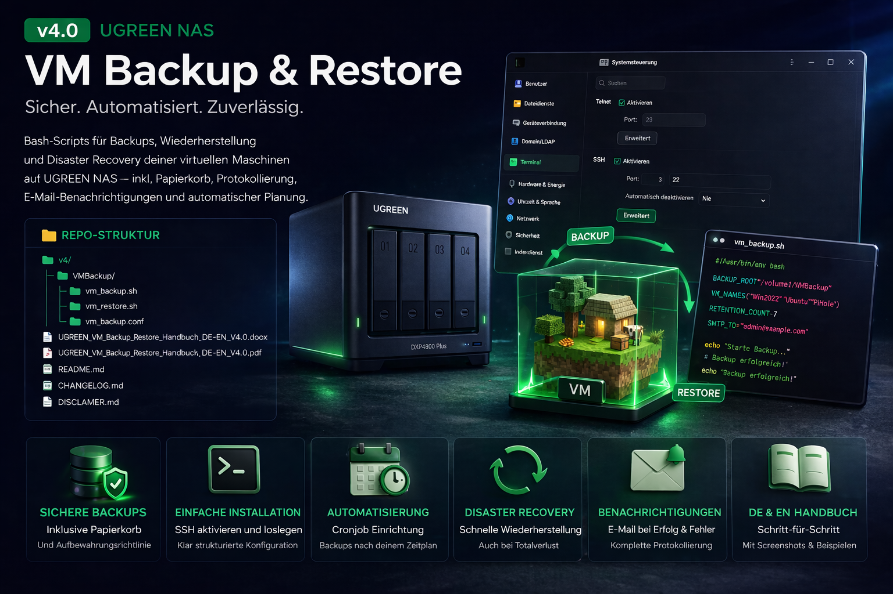

# UGREEN NAS VM Backup & Restore

[](https://github.com/Railsimulatornet/UGREEN-NAS-VM-Backup-Restore/actions/workflows/quality.yml)
[](LICENSE)



[Deutsch](#deutsch) · [English](#english)

## Deutsch

Backup und Wiederherstellung für virtuelle Maschinen auf **UGREEN NAS mit KVM/libvirt**. Das Paket sichert ausgewählte oder alle VMs, unterstützt Disaster Recovery und meldet den Lauf auf Wunsch per E-Mail.

### Funktionen

- Sicherung der VM-Konfiguration und dateibasierten Datenträger.
- Optionale Abschaltung laufender VMs vor dem Backup und anschließender Neustart.
- Wiederherstellung einzelner VMs sowie Disaster Recovery mit Registrierung in der UGREEN VM-App.
- Zeitgestempelte Backup-Ordner, chronologische Aufbewahrung und Logrotation.
- Deutsche und englische Skriptausgaben sowie E-Mail bei Erfolg oder Fehler.
- Automatischer Betrieb per Cronjob.

### Voraussetzungen

- UGREEN NAS mit eingerichteter VM-App, KVM/libvirt und Zugriff auf die VM-Daten.
- SSH-Zugang mit ausreichenden Rechten; führe Backup und Restore in einer Root-Sitzung aus.
- Bash, `virsh` und `rsync`; für die Registrierung in der UGREEN-Datenbank außerdem `sqlite3`.
- Für SMTP-Mailversand Python 3 und passende Zugangsdaten; alternativ ein eingerichtetes `sendmail`.
- Genügend Speicher am Backup-Ziel und ein geeignetes Wartungsfenster für VM-Unterbrechungen.

### Schnellstart

1. Lade das Paket aus dem [aktuellen Release](https://github.com/Railsimulatornet/UGREEN-NAS-VM-Backup-Restore/releases/latest) oder verwende [VMBackup/](VMBackup/) aus dem Repository.
2. Erstelle auf der NAS `/volume1/VMBackup/` und kopiere den **Inhalt** des Ordners `VMBackup/` dorthin. Die drei Dateien müssen direkt im Zielordner liegen.
3. Verbinde dich per SSH und setze die Ausführungsrechte:

```bash
sudo -i
chmod +x /volume1/VMBackup/vm_backup.sh /volume1/VMBackup/vm_restore.sh
```

4. Bearbeite `/volume1/VMBackup/vm_backup.conf`. Setze Backup-Ziel, VM-Auswahl, Verhalten beim Stoppen und gegebenenfalls SMTP-Daten.
5. Starte ein manuelles Backup:

```bash
cd /volume1/VMBackup
./vm_backup.sh
```

Prüfe danach den neuen Backup-Ordner und `vm_backup.log`, bevor du den regelmäßigen Lauf einrichtest.

### Konfiguration

Die Skripte verwenden standardmäßig [vm_backup.conf](VMBackup/vm_backup.conf) aus ihrem eigenen Ordner.

| Einstellung | Bedeutung |
|---|---|
| `SCRIPT_LANG="de"` / `"en"` | Sprache der Skriptausgaben |
| `BACKUP_ROOT` | Zielordner für die Sicherungen |
| `VM_NAMES="Win2022 Windows11"` | Auswahl über VM-Titel, durch Leerzeichen getrennt |
| `VM_DOMAINS` | Direkte libvirt-Domainnamen; hat Vorrang vor `VM_NAMES` |
| `STOP_VMS="yes"` | Laufende VMs vor der Sicherung herunterfahren |
| `RESTART_VMS="yes"` | Zuvor laufende, gestoppte VMs danach wieder starten |
| `STOP_ONLY_BACKUP_VMS` | `yes`: nur ausgewählte VMs stoppen; `no`: alle laufenden VMs |
| `RETENTION_COUNT` | Anzahl aufzubewahrender Läufe; `0` deaktiviert die automatische Löschung |
| `LOG_FILE`, `RESTORE_LOG_FILE` | Backup- und Restore-Log |
| `LOG_MAX_SIZE_MB`, `LOG_MAX_FILES` | Logrotation |
| `SMTP_SERVER`, `SMTP_PORT`, `SMTP_USER`, `SMTP_PASS`, `SMTP_FROM`, `SMTP_TO` | Mailversand |
| `MAIL_ON`, `MAIL_FORMAT` | `always`, `error` oder `never`; `html` oder `text` |

Sind `VM_NAMES` und `VM_DOMAINS` leer, werden alle gefundenen VMs gesichert. Die Vorlage verwendet **`STOP_ONLY_BACKUP_VMS="no"`**: Bei aktiviertem Stoppen können auch laufende VMs außerhalb der Backup-Auswahl heruntergefahren werden. Setze den Wert auf `yes`, wenn du nur die ausgewählten VMs unterbrechen möchtest.

### Wiederherstellung

Ersetze VM-Namen und Zeitstempel durch deine tatsächliche VM und den vorhandenen Backup-Ordner. Ein Restore schreibt die gesicherten Datenträger zurück; sichere gegebenenfalls noch benötigte aktuelle Daten vorher.

Bestehende VM wiederherstellen:

```bash
cd /volume1/VMBackup
./vm_restore.sh Win2022 /volume1/VMBackup/2026_09_28_21-30-00
```

Wenn die VM in der VM-App beziehungsweise libvirt nicht mehr vorhanden ist, verwende Disaster Recovery:

```bash
./vm_restore.sh --dr Win2022 /volume1/VMBackup/2026_09_28_21-30-00
```

Der DR-Modus definiert die VM aus dem gesicherten XML, kopiert die Datenträger und registriert die VM in der UGREEN-Datenbank. Beachte anschließend die Hinweise des Skripts zur VM-Konsole und zum Freigabelink in UGOS.

Weitere Optionen zeigt:

```bash
./vm_restore.sh --help
```

Das [Handbuch](UGREEN_VM_Backup_Restore_Handbuch_DE-EN_V4.0.pdf) erklärt unter anderem Ziel-Volumes, Startverhalten und Disaster Recovery ausführlich.

### Zeitplan

Öffne mit `crontab -e` den Zeitplan der Root-Sitzung. Beispiel für täglich 03:00 Uhr:

```cron
0 3 * * * /volume1/VMBackup/vm_backup.sh >> /volume1/VMBackup/cron.log 2>&1
```

### Aktualisierung und v4.0.1

**Behalte deine eigene `vm_backup.conf`.** Vergleiche neue Konfigurationsoptionen mit deiner Datei, statt sie durch die Vorlage zu ersetzen. Für das Update von v4.0 auf v4.0.1 genügt der Austausch von `VMBackup/vm_backup.sh`; `vm_restore.sh` bleibt auf dem bisherigen Stand.

Neue Sicherungen verwenden `JJJJ_MM_TT_HH-MM-SS`, zum Beispiel `2026_09_28_21-30-00`. Bestehende Sicherungen im Format `TT_MM_JJJJ_HH-MM-SS` bleiben beim Restore und bei der chronologischen Aufbewahrung verwendbar. Du musst sie nicht umbenennen.

Die automatische Bereinigung erfolgt nur nach erfolgreichem Backup. Bei einem fehlgeschlagenen Lauf bleiben vorhandene Sicherungen erhalten und das Skript beendet sich mit Exitcode 1. Nicht lesbare Datenträgerlisten und VMs ohne dateibasierte Datenträger gelten als Fehler.

Positive ganze Werte für `RETENTION_COUNT` legen die Zahl der aufzubewahrenden Läufe fest. `0` deaktiviert die Löschung. Ungültige Werte deaktivieren die Bereinigung mit einer Warnung.

Das mitgelieferte Handbuch bleibt auf Stand **V4.0**. Seine Beispiele mit dem alten Datumsformat sind weiterhin gültig; für neue Backups verwendest du den tatsächlich angelegten Ordnernamen.

### Projektstruktur und Dokumentation

| Inhalt | Pfad |
|---|---|
| Backup-Skript | [VMBackup/vm_backup.sh](VMBackup/vm_backup.sh) |
| Restore-Skript | [VMBackup/vm_restore.sh](VMBackup/vm_restore.sh) |
| Konfigurationsvorlage | [VMBackup/vm_backup.conf](VMBackup/vm_backup.conf) |
| Handbuch Deutsch/Englisch | [UGREEN_VM_Backup_Restore_Handbuch_DE-EN_V4.0.pdf](UGREEN_VM_Backup_Restore_Handbuch_DE-EN_V4.0.pdf) |
| Änderungen | [CHANGELOG.md](CHANGELOG.md) |
| Nutzungshinweise | [DISCLAIMER.md](DISCLAIMER.md) |

### Fehlersuche

| Problem | Prüfen |
|---|---|
| Skript startet nicht | Ausführungsrechte, Bash und Dateipfade |
| Keine VM ausgewählt | `VM_NAMES`, `VM_DOMAINS` und die in libvirt vorhandenen VMs |
| Keine Mail | `MAIL_ON`, SMTP-Daten und `vm_backup.log` |
| SSH-Zugriff fehlt | SSH in UGOS und Benutzerrechte |
| Konsole nach DR fehlt | Skriptausgabe beachten, VM-App neu laden und Freigabelink bestätigen |

### Lizenz und Nutzung

[MIT-Lizenz](LICENSE). Beachte die [Nutzungshinweise](DISCLAIMER.md) und halte eigene Sicherungen vor. Roman Glos / UGREEN NAS Community. Rückmeldungen über GitHub sind willkommen.

## English

Backup and restore for virtual machines on **UGREEN NAS with KVM/libvirt**. The package backs up selected or all VMs, supports disaster recovery and can report each run by email.

### Features

- Backup of VM configuration and file-based disks.
- Optional shutdown of running VMs before backup and restart afterwards.
- Restore of individual VMs and disaster recovery with registration in the UGREEN VM app.
- Timestamped backup folders, chronological retention and log rotation.
- German and English script output, with email on success or failure.
- Automated operation through cron.

### Requirements

- UGREEN NAS with the VM app, KVM/libvirt and access to VM data.
- SSH access with sufficient permissions; run backup and restore in a root session.
- Bash, `virsh` and `rsync`; registration in the UGREEN database also requires `sqlite3`.
- Python 3 and valid credentials for SMTP email, or a configured `sendmail` as an alternative.
- Enough storage at the backup destination and a suitable maintenance window for VM downtime.

### Quick start

1. Download the package from the [latest release](https://github.com/Railsimulatornet/UGREEN-NAS-VM-Backup-Restore/releases/latest) or use [VMBackup/](VMBackup/) from the repository.
2. Create `/volume1/VMBackup/` on the NAS and copy the **contents** of `VMBackup/` into it. The three files must be directly inside the destination folder.
3. Connect over SSH and set execution permissions:

```bash
sudo -i
chmod +x /volume1/VMBackup/vm_backup.sh /volume1/VMBackup/vm_restore.sh
```

4. Edit `/volume1/VMBackup/vm_backup.conf`. Set the backup destination, VM selection, shutdown behaviour and, if used, SMTP details.
5. Start a manual backup:

```bash
cd /volume1/VMBackup
./vm_backup.sh
```

Check the new backup folder and `vm_backup.log` before setting up a regular schedule.

### Configuration

By default, the scripts use [vm_backup.conf](VMBackup/vm_backup.conf) from their own folder.

| Setting | Meaning |
|---|---|
| `SCRIPT_LANG="de"` / `"en"` | Script output language |
| `BACKUP_ROOT` | Backup destination folder |
| `VM_NAMES="Win2022 Windows11"` | Select VM titles, separated by spaces |
| `VM_DOMAINS` | Direct libvirt domain names; takes precedence over `VM_NAMES` |
| `STOP_VMS="yes"` | Shut down running VMs before backing up |
| `RESTART_VMS="yes"` | Restart previously running VMs that were stopped |
| `STOP_ONLY_BACKUP_VMS` | `yes`: stop selected VMs only; `no`: stop all running VMs |
| `RETENTION_COUNT` | Number of runs to keep; `0` disables automatic deletion |
| `LOG_FILE`, `RESTORE_LOG_FILE` | Backup and restore logs |
| `LOG_MAX_SIZE_MB`, `LOG_MAX_FILES` | Log rotation |
| `SMTP_SERVER`, `SMTP_PORT`, `SMTP_USER`, `SMTP_PASS`, `SMTP_FROM`, `SMTP_TO` | Email delivery |
| `MAIL_ON`, `MAIL_FORMAT` | `always`, `error` or `never`; `html` or `text` |

If `VM_NAMES` and `VM_DOMAINS` are empty, all detected VMs are backed up. The template uses **`STOP_ONLY_BACKUP_VMS="no"`**: When shutdown is enabled, running VMs outside the backup selection may also be shut down. Set it to `yes` to interrupt selected VMs only.

### Restore

Replace the VM name and timestamp with your actual VM and an existing backup folder. A restore writes the saved disks back; preserve any current data you still need beforehand.

Restore an existing VM:

```bash
cd /volume1/VMBackup
./vm_restore.sh Win2022 /volume1/VMBackup/2026_09_28_21-30-00
```

If the VM no longer exists in the VM app or libvirt, use disaster recovery:

```bash
./vm_restore.sh --dr Win2022 /volume1/VMBackup/2026_09_28_21-30-00
```

DR mode defines the VM from its saved XML, copies the disks and registers the VM in the UGREEN database. Afterwards, follow the script's instructions for the VM console and share link in UGOS.

To list further options:

```bash
./vm_restore.sh --help
```

The [manual](UGREEN_VM_Backup_Restore_Handbuch_DE-EN_V4.0.pdf) explains target volumes, startup behaviour and disaster recovery in detail.

### Schedule

Open the root session's schedule with `crontab -e`. Example for a daily run at 03:00:

```cron
0 3 * * * /volume1/VMBackup/vm_backup.sh >> /volume1/VMBackup/cron.log 2>&1
```

### Updates and v4.0.1

**Keep your own `vm_backup.conf`.** Compare new configuration options with your file instead of replacing it with the template. Updating from v4.0 to v4.0.1 only requires replacing `VMBackup/vm_backup.sh`; `vm_restore.sh` remains at its previous version.

New backups use `YYYY_MM_DD_HH-MM-SS`, for example `2026_09_28_21-30-00`. Existing backups using `DD_MM_YYYY_HH-MM-SS` remain usable for restore and chronological retention. They do not need to be renamed.

Automatic cleanup runs only after a successful backup. If a run fails, existing backups are kept and the script exits with code 1. Unreadable disk lists and VMs without file-based disks are treated as errors.

Positive integer values for `RETENTION_COUNT` set the number of runs to keep. `0` disables deletion. Invalid values disable cleanup with a warning.

The supplied manual remains at **V4.0**. Its examples using the old date format are still valid; use the actual new folder name when restoring newer backups.

### Project structure and documentation

| Content | Path |
|---|---|
| Backup script | [VMBackup/vm_backup.sh](VMBackup/vm_backup.sh) |
| Restore script | [VMBackup/vm_restore.sh](VMBackup/vm_restore.sh) |
| Configuration template | [VMBackup/vm_backup.conf](VMBackup/vm_backup.conf) |
| German/English manual | [UGREEN_VM_Backup_Restore_Handbuch_DE-EN_V4.0.pdf](UGREEN_VM_Backup_Restore_Handbuch_DE-EN_V4.0.pdf) |
| Changes | [CHANGELOG.md](CHANGELOG.md) |
| Usage notes | [DISCLAIMER.md](DISCLAIMER.md) |

### Troubleshooting

| Problem | Check |
|---|---|
| Script does not start | Execution permissions, Bash and file paths |
| No VM selected | `VM_NAMES`, `VM_DOMAINS` and the VMs available in libvirt |
| No email | `MAIL_ON`, SMTP settings and `vm_backup.log` |
| No SSH access | SSH in UGOS and user permissions |
| Console missing after DR | Follow script output, reload the VM app and confirm the share link |

### License and usage

[MIT License](LICENSE). Read the [usage notes](DISCLAIMER.md) and maintain your own backups. Roman Glos / UGREEN NAS Community. Feedback through GitHub is welcome.
